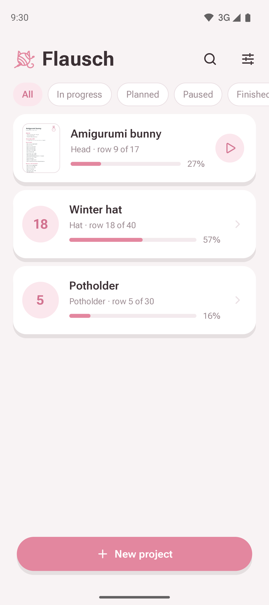
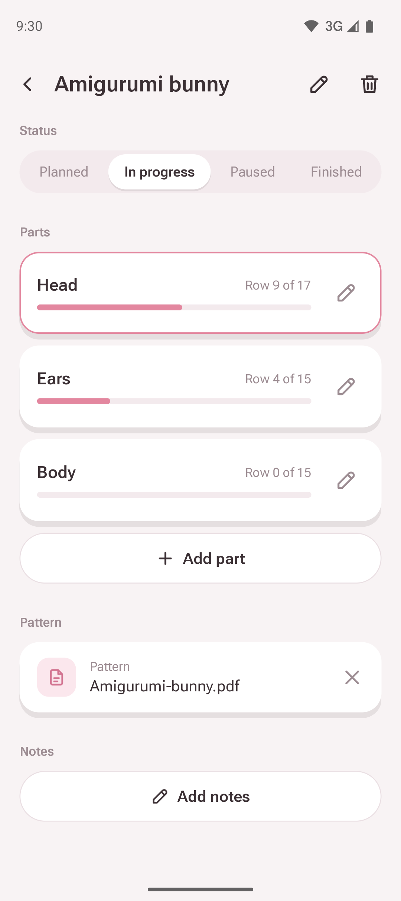
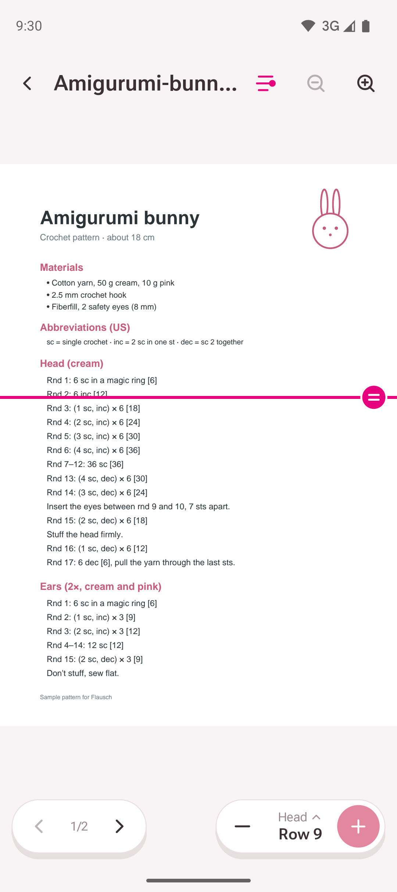
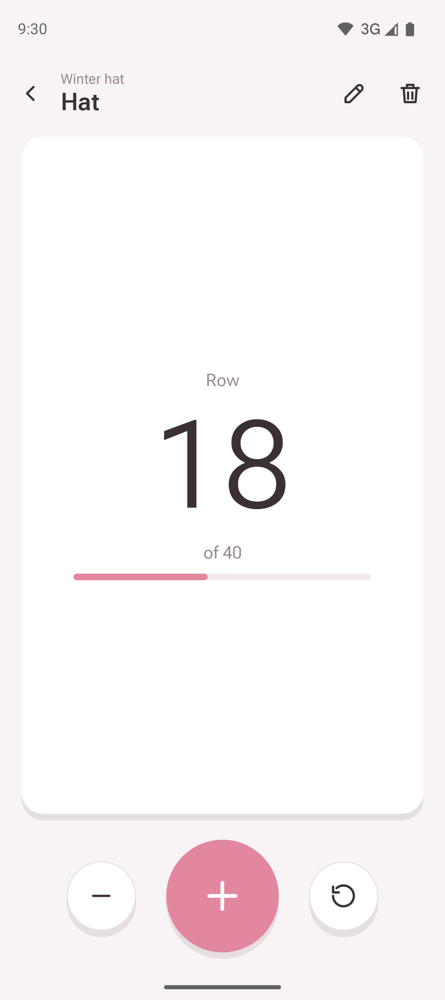

# Flausch

Row counter and pattern viewer for crocheting – simple, offline, free. *Flausch* is German for fluff (from
*flauschig*, fluffy).

## Features

**Projects and parts**

- Split a project into parts (e.g. head, ears, body), each with its own row counter and an optional row goal
- Parts made several times (e.g. 4 legs) count each piece
- Project status (planned, in progress, paused, finished) and notes
- The project list shows the pattern cover, the current part and the total progress
- Search by project or part name, continue where you left off with one tap

**Patterns**

- Import PDF patterns; they are copied into the app and rendered on your device
- Count rows right in the pattern, switch parts there or enlarge the counter
- Swipe to turn pages, zoom in with a double tap
- A movable reading line marks your row and remembers its position on every page

**Made for crocheting**

- Large buttons for one-handed use, counting with the volume keys, the screen stays on while you work
- Backup and restore of all data as a ZIP file, e.g. when you switch phones
- Light and dark mode, English and German, works with TalkBack

Flausch runs on Android 10 and newer.

## Privacy

Flausch requests no permissions, has no internet access and collects no data. No account, no ads, no tracking.
Projects and PDFs stay on your device.

## Support

I make Flausch on my own, in my spare time. If it helps you, you can buy me a coffee via
[GitHub Sponsors](https://github.com/sponsors/ldrick) or [Liberapay](https://liberapay.com/ldrick). Bugs and ideas
are welcome as [issues](https://github.com/ldrick/flausch/issues).

## Contributing

Flausch is written in Rust with the [Slint](https://slint.dev) UI toolkit. See [CONTRIBUTING.md](CONTRIBUTING.md)
for building and testing, and [`AGENTS.md`](AGENTS.md) for the architecture and conventions.

## License

Flausch is free software under the GNU General Public License v3.0 or later, see [LICENSE](LICENSE).

Slint is used under its Royalty-free License 2.0 (mobile apps allowed; requires an attribution, e.g. the
"Made with Slint" badge in the app or on its web page) – alternatively GPLv3.
